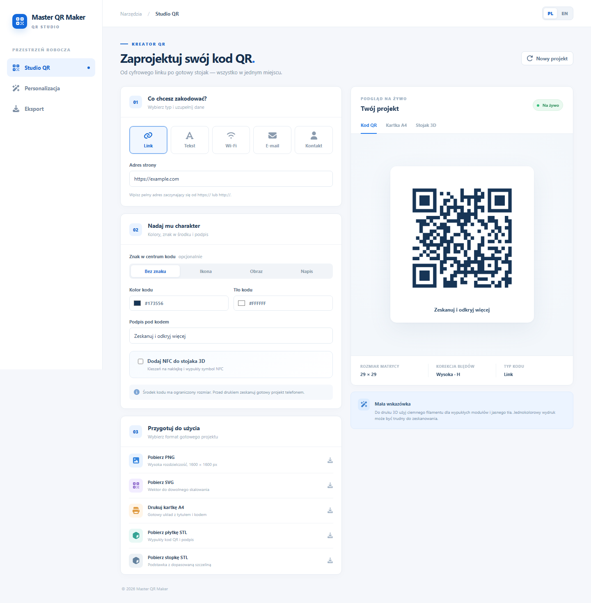

# Master QR Maker

Lokalna aplikacja do projektowania kodów QR, wydruków A4 i stojaków do druku 3D. Nie wymaga konta, backendu ani połączenia z internetem. Zawartość kodu, obrazy i pliki wynikowe są przetwarzane w przeglądarce.

Krótka instrukcja po polsku i angielsku: [manual.md](manual.md).



## Uruchomienie

Otwórz `index.html` w aktualnej przeglądarce. Jeśli przeglądarka ogranicza pobieranie plików ze stron `file://`, uruchom lokalny serwer w katalogu projektu:

```powershell
python -m http.server 8765 --bind 127.0.0.1
```

Następnie otwórz `http://127.0.0.1:8765`. Serwer nasłuchuje tylko na Twoim komputerze. Nie ma zewnętrznych skryptów, fontów ani usług sieciowych.

## Funkcje

- Tryby: link, tekst, Wi-Fi, e-mail i kontakt vCard.
- Interfejs po polsku i angielsku; przełącznik PL/EN znajduje się w prawym górnym rogu.
- Własne kolory, podpis oraz znak w centrum kodu: tekst, gotowa ikona (Wi-Fi, dom, NFC, radio i inne) albo plik PNG, JPG, WEBP lub SVG. Obrazy są lokalnie zmniejszane i osadzane w pliku wynikowym.
- Opcjonalne linie SSID i hasła pod kodem Wi-Fi oraz dodatkowy napis. Układ trafia do podglądu, PNG, SVG, A4 i modelu 3D.
- Podgląd kodu, kartki A4 i stojaka.
- Eksport PNG 1600 × 1600 px, SVG oraz wydruk A4.
- Dwa pliki STL: płytka z wypukłym kodem i podpisem oraz stopka ze szczeliną. Opcjonalnie płytka ma zamkniętą kieszeń na naklejkę NFC i wypukły symbol.

Przykład układu Wi-Fi i NFC: [podgląd nowych opcji](preview-features.png).
Wybór ikon Font Awesome: [podgląd selektora](preview-icons.png).

## Druk 3D

Płytkę drukuj płasko, kodem do góry. Bez NFC grubość płytki to 3 mm; z NFC 4 mm. Kod, napis i symbol NFC wystają o 0,8 mm. Szczelina stopki jest dopasowana do wybranej grubości. Wymiary płytki rosną wraz z gęstością kodu, tak aby szerokość pojedynczego modułu wynosiła co najmniej 1,2 mm. Sprawdź wymiary pod podglądem i dopasuj je do pola roboczego drukarki.

Po włączeniu NFC wybierz miejsce naklejki: za kodem QR, za podpisem albo za symbolem NFC. Wpisz rzeczywistą średnicę (15–30 mm) i grubość (0,2–1,2 mm) naklejki. Kieszeń jest kwadratowa i ma 1,2 mm luzu względem średnicy. Naklejkę zaprogramuj osobno. W slicerze obejrzyj przekrój modelu i ustaw pauzę tuż przed pierwszą warstwą zamykającą kieszeń; sugerowaną wysokość Z pokazuje interfejs. Włóż naklejkę, upewnij się, że nie wystaje ponad kieszeń, i wznów druk. Wydrukuj próbkę przed wykonaniem większej serii.

Kontrast ma znaczenie: dla skanowalnego modelu zastosuj zmianę filamentu na warstwie wypukłych modułów lub pomaluj je ciemnym kolorem na jasnym tle. Obraz w centrum modelu jest progowany do dwukolorowej mozaiki. Drobne szczegóły zdjęcia mogą zniknąć. Przed drukiem seryjnym wydrukuj próbkę i zeskanuj ją telefonem. Eksport STL zawiera stykające się bryły; w slicerze włącz scalanie nakładających się objętości, jeśli program o to pyta.

## Prywatność

Strona nie zapisuje wprowadzonych danych i niczego nie wysyła do internetu. Lokalny serwer HTTP, jeśli go uruchomisz, tylko udostępnia pliki aplikacji na `127.0.0.1`. Dane wpisane do kodu QR są jawne dla każdego, kto zeskanuje gotowy kod.

## Biblioteka

Generator matrycy QR korzysta z lokalnie dołączonego [QRCode.js](https://github.com/davidshimjs/qrcodejs) (MIT). Dodano metodę zwracającą samą matrycę na potrzeby eksportu. Informacja licencyjna znajduje się w `vendor/LICENSE`.

Ikony interfejsu i siedem ikon do środka kodu pochodzą z [Font Awesome Free Solid](https://github.com/FortAwesome/Font-Awesome). Ich lokalne pliki źródłowe, atrybucja i licencja CC BY 4.0 są w `vendor/fontawesome/`. Symbol NFC jest własnym rysunkiem używanym w selektorze, kodzie QR, podglądzie stojaka i STL, ponieważ ikona NFC Font Awesome nie należy do pakietu Free 7.3.1. Własny SVG możesz wczytać lokalnie przez opcję „Obraz”. Wybrane ścieżki SVG są osadzone w `index.html`, aby strona działała bez sieci.
